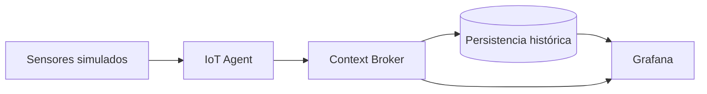

# Proyecto 3 · Plataforma FIWARE

> Plataforma FIWARE con sensores simulados, persistencia histórica y dashboard en tiempo real con Grafana.

## Descripción y objetivo

Despliegue de una plataforma **FIWARE** (**Context Broker** + **IoT Agents**) con sensores simulados, persistencia histórica de los datos y un dashboard en tiempo real con **Grafana**.

## Arquitectura

*Diagrama provisional del Bloque 0. Se actualizará al terminar cada bloque.*

## Fuentes de datos

| Fuente | URL / origen | Formato | Frecuencia de actualización | Licencia | Última ingesta |
|---|---|---|---|---|---|
| Sensores simulados | Generados por el propio proyecto | Pendiente | Tiempo real | No aplica | Pendiente |

## Estructura del repositorio

| Carpeta | Contenido |
|---|---|
| `ingesta/` | Sensores simulados y envío de medidas a la plataforma |
| `etl/` | Persistencia histórica y transformaciones |
| `dashboard/` | Dashboards de Grafana en tiempo real |
| `docs/` | Capturas y diagramas |

## Cómo desplegar el entorno

Pendiente de completar cuando se defina el `docker-compose.yml` de la plataforma (Bloque 6).

## Bitácora de prácticas

### Bloque 0 · Entorno

**Objetivo:** dejar preparado el repositorio Git independiente del proyecto, con su estructura de carpetas, `.gitignore` y README inicial.

**Pasos realizados:**

1. Creación del repositorio con `git init` y la rama `main`.
2. Creación de las carpetas `ingesta/`, `etl/`, `dashboard/` y `docs/`.
3. Configuración del `.gitignore`.
4. Redacción del README inicial.
5. Primer commit y publicación en GitHub.

**Problemas encontrados y solución:** ninguno por ahora.

**Resultado:** repositorio publicado en GitHub con la estructura inicial.

## Equipo

- Jorge Esteban García